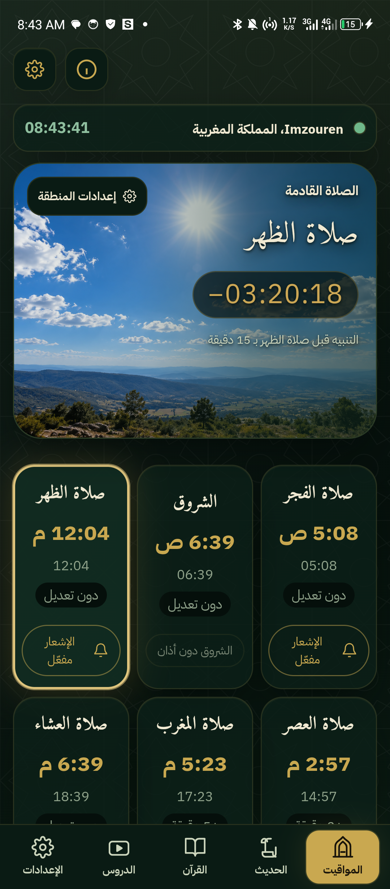
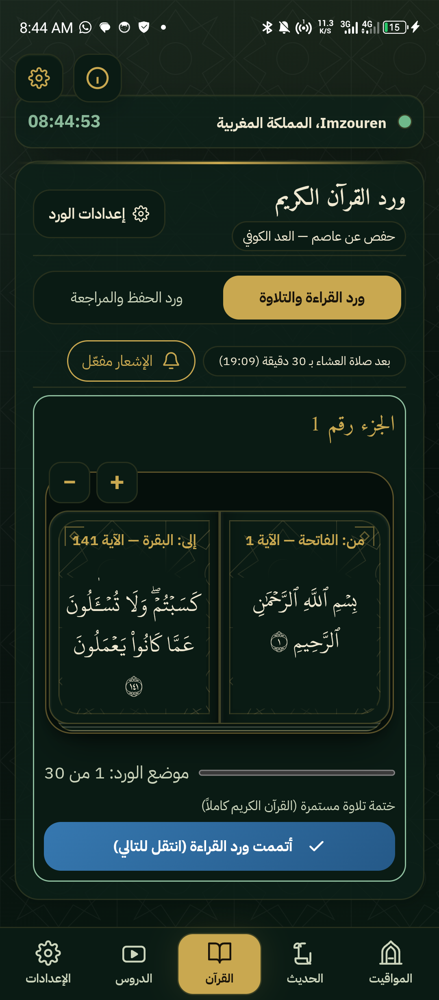
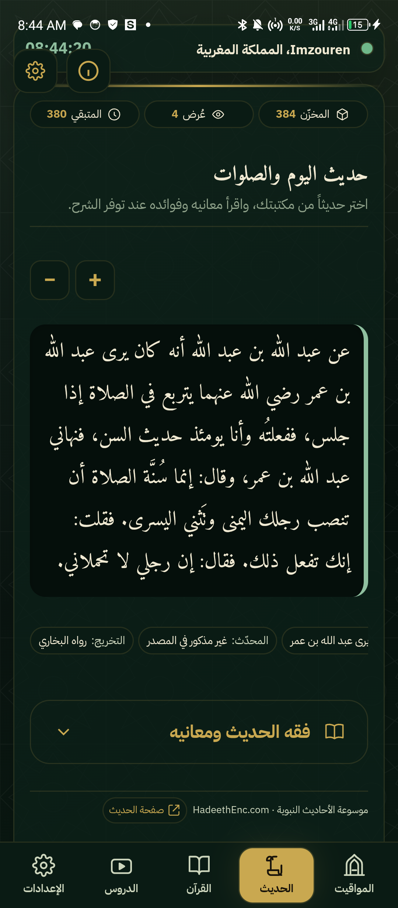
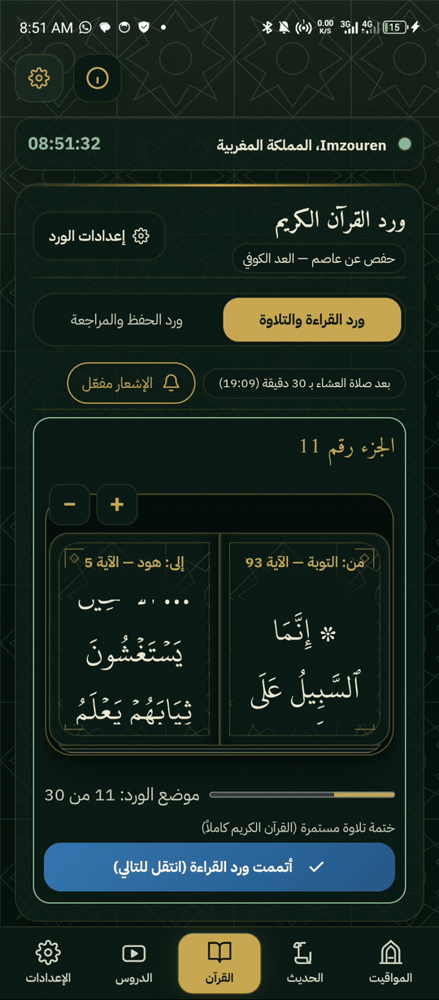

بسم الله الرحمن الرحيم

<p align="center"></p>

# محراب — وقف عن جدّي رحمه الله

هذا المشروع وقف عن جدّي رحمه الله، رجاء أن يصله ثواب هذا العمل وأن ينفع الله به. خُصّص محراب لهذا الغرض إثر وفاته.

يساعد محراب على تقليل التشتيت والمحافظة على الفروض والسنن اليومية، وبناء نظام يومي نافع من الصلاة والقرآن والذكر والتعلّم. التطبيق أداة؛ والمنفعة تتحقق بإحسان استخدام الأدوات المتاحة.

# محراب للهاتف

محراب تطبيق Android يساعدك على تنظيم الصلاة والورد اليومي، ويوفر مساحة هادئة لقراءة القرآن والأحاديث والمحافظة على عادات يومية نافعة.

صنعت هذا المشروع ليكون نافعاً ومتاحاً دون اشتراك أو إعلانات. يعمل محلياً، ولا يحتاج إلى حساب خاص بمحراب. وتبقى المواقيت المحسوبة والمواد المرفقة والتقدم في الأوراد متاحة دون إنترنت.

## تحميل التطبيق

الإصدار 1.0.0 متاح للتجربة والمراجعة. هذه نسخة تجريبية، ويُرحّب ببلاغات الأخطاء والملاحظات.

- [تحميل APK موقّع — Android Release](https://github.com/Mohamed2006-Dev/mihrab-phone/releases/download/v1.0.0/Mihrab-Phone-1.0.0.apk)
- [صفحة الإصدار وملف التحقق من سلامة التحميل](https://github.com/Mohamed2006-Dev/mihrab-phone/releases/tag/v1.0.0)
- [جميع الإصدارات](https://github.com/Mohamed2006-Dev/mihrab-phone/releases)

تُثبّت نسخة التجربة من ملف APK على جهاز Android متوافق. إذا رفض النظام تحديث نسخة موجودة بسبب اختلاف التوقيع، فاستخدم نسخة تحمل التوقيع نفسه؛ إزالة التطبيق قد تؤدي إلى فقد بياناته المحلية.

## ماذا يقدم محراب؟

- مواقيت الصلاة بحسب المنطقة وطريقة الحساب، مع حساب محلي والتحقق اليومي عبر الإنترنت وفق إعداداتك، وحفظ مواقيت اليوم للمنطقة.
- تحديد موقع الهاتف بإذنك، أو اختيار المدينة والإحداثيات يدوياً دون منح صلاحية الموقع، مع التحكم بالتحديث التلقائي.
- الأذان والتنبيهات، مع تخصيص كل صلاة والجمعة وأوقات التذكير.
- ورد قراءة مستقل عن ورد الحفظ والمراجعة، مع حفظ التقدم ودعم روايتي حفص وورش وتكبير النص ضمن حدود مناسبة.
- أحاديث وشروح من موسوعة الأحاديث النبوية HadeethEnc، مع معلومات التوثيق والبحث في المكتبة وإمكانية نسخ الحديث وحفظه كصورة.
- اقتراح مقاطع من قنوات يوتيوب التي تختارها، وفتح المقطع للمشاهدة، مع التحكم بإشعارات الدروس.
- ويدجت للشاشة الرئيسية يعرض الصلاة والوقت المتبقي أو المنقضي، اعتماداً على جدول المواقيت المحفوظ.
- خيارات للمظهر وحجم النصوص والأداء، وأدوات للاطلاع على التخزين واستهلاك الإنترنت والتحكم باتصال الخدمات.

يمكنك مراجعة المدينة والمنطقة الزمنية وطريقة الحساب من إعدادات المنطقة. عند عدم منح إذن الموقع يظل الضبط اليدوي متاحاً، وقد يؤثر عدم تحديث المنطقة عند الانتقال على دقة المواقيت. يتيح قسم «أخرى» التحكم بالعمليات التلقائية. وقد يختلف عرض الرسم القرآني على بعض الشاشات؛ يسعدني تلقي بلاغ واضح إن وجدت خطأ.

## جولة بالصور

<p align="center">



</p>

### تقليب المصحف على الهاتف

<p align="center"></p>

## البيانات والخصوصية

يحفظ محراب إعداداتك وتقدمك والمواد المخزنة على هاتفك. لا نستخدم حسابات سحابية لمزامنتها، ولا نضيف أدوات تتبع أو إعلانات.

يُطلب إذن الموقع من Android عند الحاجة إليه؛ ويمكنك رفضه واختيار منطقتك يدوياً. يستخدم التطبيق خدمة موقع الجهاز لتحديد الإحداثيات، وقاعدة مدن محلية لتعيين المنطقة، ولا يعتمد على عنوان IP لتحديد مدينتك. التحديث التلقائي للموقع مرتبط بالسماح للنظام بالوصول إليه، بينما تحفظ اختيار التحقق التلقائي من المواقيت من الإعدادات.

عند السماح بالإنترنت، يتصل التطبيق بمصادر الأحاديث والمواقيت وخلاصات يوتيوب وصورها. لهذه الخدمات سياساتها الخاصة، وقد تتلقى بيانات الاتصال مثل عنوان IP. يمكنك التحكم في الاتصالات من الإعدادات. عند منع الشبكة يستمر العمل المحلي، بينما تتوقف الخدمات التي تحتاج إلى جلب بيانات جديدة.

يعتمد وصول الإشعارات على أذونات Android وإعدادات الجهاز المتعلقة بالتنبيهات والعمل في الخلفية. التبليغ عن الأخطاء اختياري: تراجع المسودة أولاً، ثم تكمل إرسالها بنفسك عبر المنصة التي تختارها. لا يرسل التطبيق سجلات جهازك تلقائياً.

## تشغيل المشروع من المصدر

تحتاج إلى Node.js وnpm وAndroid Studio مع Android SDK وJDK متوافقين مع إعدادات المشروع. من مجلد المشروع:

```sh
npm ci
npm run cap:sync
```

افتح مجلد `android` في Android Studio، ثم اختر محاكياً أو جهاز Android متصلاً واضغط Run. ويمكن إنشاء نسخة اختبار من مجلد `android`:

```sh
# Windows
gradlew.bat assembleDebug

# macOS / Linux
./gradlew assembleDebug
```

يوجد APK الناتج في `android/app/build/outputs/apk/debug/`. لإعادة تجهيز ملفات الواجهة وحدها استخدم `npm run prepare:web`، ثم أعد المزامنة قبل تشغيل التعديلات على Android.

المحركات في `src/engines/`، والواجهة في `src/ui/`، وخدمات الهاتف في `src/platform/`، ومشروع Android في `android/`، والقوالب في `themes/`.

حزمة المصدر تحتوي الملفات اللازمة للتطبيق وبياناته المرجعية، وتستبعد الإعدادات الشخصية والكاش ومخرجات البناء والاختبارات والسجلات المحلية ومفاتيح التوقيع. ملف `data/personal-data.json` في حزمة المراجعة نموذج فارغ لبيانات الدعم والتبليغ الاختيارية، وعدم تعبئته لا يمنع تشغيل الخدمات الأساسية. توقيع نسخة النشر يُجهّز محلياً ولا يُضمّن في حزمة المصدر.

## الاستخدام والحقوق

يمكنك قراءة الكود ودراسته وتعديله وإعادة توزيعه للاستخدام غير التجاري، وفق [شروط المشروع](LICENSE)، مع احترام الضوابط الشرعية وحقوق المصادر الخارجية. لا يلزم ذكر اسم المطور للكود الأصلي، لكن تبقى إشعارات وتراخيص المكتبات والخطوط والمحتوى الخارجي واجبة الاحترام. هذه شروط إتاحة مخصصة وليست رخصة مصدر مفتوح معتمدة تسمح بالاستخدام التجاري.

الدعم الوارد من هذا المشروع سيُنفق بإذن الله في تطوير هذا المشروع بالخصوص ولن يخرج عن إطاره. الدعم اختياري ولا يشتري صاحبه ميزة أو محتوى؛ يبقى التطبيق متاحاً للجميع دون دفع. تظهر وسائل الدعم داخل نافذة «عن التطبيق» عندما تُجهّز بياناتها.

الأحاديث وشروحها من [HadeethEnc](https://hadeethenc.com/ar)، وتوثيق موارد القرآن موجود في [ملف المصادر](data/quran-sources.md). تبقى المقاطع لأصحابها على يوتيوب، ولا يرفع محراب ملفاتها أو يملك محتواها.

إن انتفعت بالمشروع، فأسأل الله أن يبارك لك فيه. وإن وجدت خللاً، فبلاغك أو مساهمتك في إصلاحه يساعدان على تحسينه.

## نسخة الحاسوب

يمكنك الاطلاع على [مستودع محراب للحاسوب](https://github.com/Mohamed2006-Dev/mihrab-app) وتحميل نسخته من صفحة إصداراته.
